# DanmakuDesigner

为 [AgSTG](../AgSTG)（VB.NET / .NET 10 / WPF 弹幕 STG 引擎）制作的可视化关卡编辑器。

界面模仿 Visual Studio 2017 深色主题，关卡按时间轴编排，敌机与子弹的行为用类似 Scratch 的积木拖拽编写，并内置使用 AgSTG 真实贴图的试玩预览。编辑器可以直接导出**可编译的 VB.NET 关卡工程**，但**不会修改 AgSTG 引擎本体**。


## 功能特性

- **Visual Studio 深色主题**：菜单、工具栏、文档标签、资源管理器、属性、输出、状态栏均按 VS 2017 Dark 的配色与会话结构设计
- **多关卡游戏工程**：一个 `.dmkproj` 管理多个关卡，资源管理器中可切换、新建、复制、重命名和删除关卡；切换关卡不会丢失当前编辑状态。
- **游戏资源管理器**：新增「游戏资源」文档页，可导入/预览/移除跨关卡共享的图片与音频资源，资源路径保存在工程内。
- **背景编辑与 3D 建模**：新增「背景编辑」标签页，可添加 2D / 3D 背景图层；3D 图层提供独立的建模工具，支持简单几何体和几何面的添加。
- **背景关键帧动画**：时间轴用关键帧控制 3D 摄像机、2D 图层位移/缩放/透明度和粒子速度；3D 关键帧提供独立视角选择窗口。
- **Boss 模板**：敌机模板可切换为 Boss，在属性面板设置 Boss 名称，通过「普通贴图」「移动贴图」按钮选择动画贴图，并通过双列表选择符卡及战斗顺序。
- **符卡阶段拆分**：符卡行为提供「非符阶段开始 / 每帧」和「正式符卡阶段开始 / 每帧」四类事件积木；Boss 模板的符卡事件也可以选择全部阶段、非符阶段或正式符卡阶段。
- **粒子效果**：2D 粒子场和 3D 背景图层支持粒子模式；粒子可以纯色填充，也可以选择游戏图片资源作为填充；在背景图层属性中打开「编辑粒子积木…」，用积木控制粒子速度、位置、尺寸、寿命、透明度和颜色。
- **背景模糊**：任意背景图层都可以设置「模糊半径」，2D、3D 和粒子内容会一起模糊。
- **背景循环事件**：在背景动画轨道右键可添加循环事件，设置循环起始帧、结束帧和循环长度；循环区间必须早于事件帧，且区间内不能包含其他循环事件。
- **按对象隐藏积木**：普通小怪不会显示 Boss / 符卡相关积木，只有 Boss 模板和符卡行为才提供这些积木。
- **掉落物编辑**：敌机模板和符卡属性中的掉落物改为按类型显示数量（P 点、蓝点、信仰点、残机、残机碎片、符卡、符卡碎片），支持直接输入或 `+` / `−` 调整，不再需要手写数字字符串。
- **符卡池**：符卡集中放在左侧「关卡资源管理器 → 符卡」中；双击符卡即可编辑它的积木，符卡属性（类型、HP、时间、分数等）在右侧属性面板设置。
- **对话**：左侧新增「对话」资源分组，按 AgSTG CSV 格式编辑台词；对话结束后可选择让当前场上待命的 Boss 开打或进入下一关。
- **完整解决方案导出**：内置压缩引擎模板，导出时解压到目标目录，替换旧关卡和 `ResourcePack.TH07`，保留 TH07 按钮贴图，并用游戏代码名重写 TH07 外壳工程；导出后可立即编译。
- **编译并运行**：`运行 → 编译并运行…` 会检测 .NET 10 SDK，编译导出的解决方案并启动生成的 exe。
- **游戏属性**：在左侧选中游戏根节点，可设置启动页面、标题页面、游戏页面背景图片和标题页面 BGM。
- **时间轴关卡编排**：多轨道、片段拖拽与缩放、标尺吸附、播放头、静音/锁定、事件轨道、片段属性编辑。
- **Scratch 风格积木**：事件积木（帽子）＋ 运动 / 攻击 / 控制积木；C 形嵌套、字段内联编辑、右键插入取值器、拖拽排序与嵌套。
- **真实贴图预览**：直接读取 AgSTG `ResourcePack` 的子弹、敌机、自机贴图，用内置解释器实时播放；预览面板还可以勾选「引擎」，直接使用 AgSTG 的 STG 控件运行关卡。
- **代码生成与多工程导出**：为每个关卡生成独立 `.vb` / 背景 `UserControl` / `.vbproj`，同时生成 `GameResources` 资源包工程、解决方案和集成说明。
- **校验与输出**：未选择子弹样式、引用失效、等待位置错误、片段超出关卡长度等问题都会实时报告，双击可跳转。
- **撤销 / 重做**：结构编辑与字段编辑均进入撤销栈（最多 80 步）。
- **示例游戏**：`samples/DemoStage.dmkproj`，包含两个关卡、横向/纵向妖精编队、两侧阴阳玉、幽灵随机游走、大蝴蝶血量阶段、Boss 模板，以及 2D/3D 背景图层和对应的背景关键帧轨道。

| 积木编程 | 试玩预览 |
| --- | --- |
| 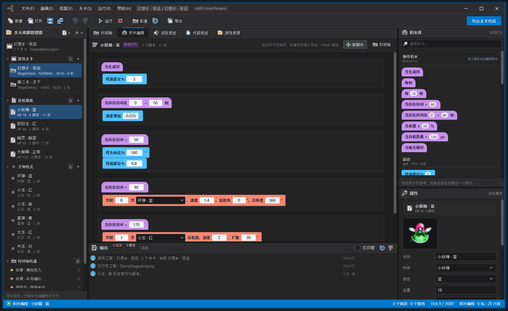 | 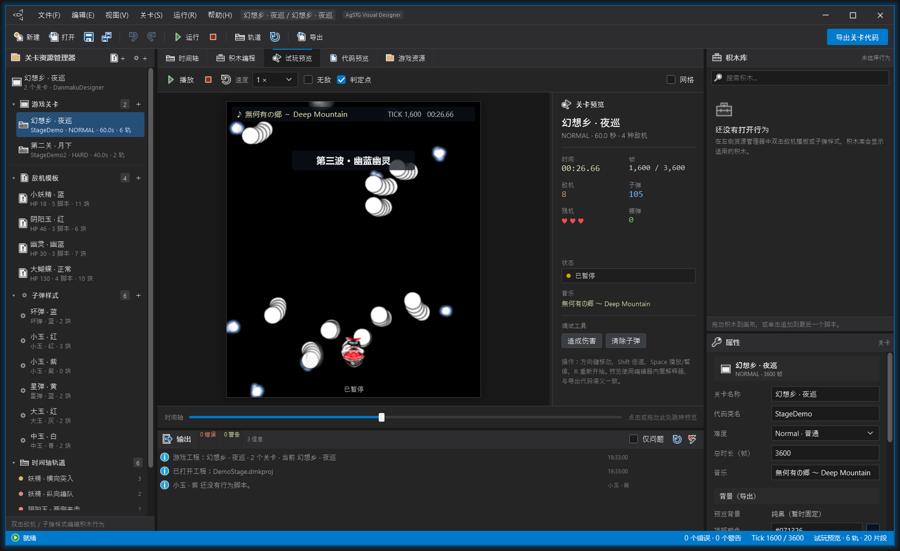 |

| 代码预览 |
| --- |
| 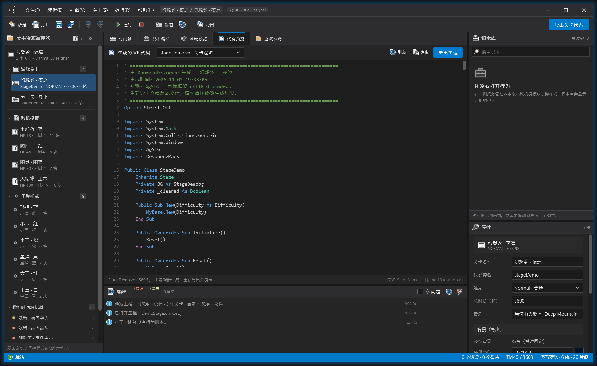 |

### 窗口强调色

窗口四周有一圈 10px 的外发光和 1px 强调线，底部状态栏使用同一强调色。颜色随编辑器状态自动切换，并在状态栏上同步：

| 状态 | 颜色 | 触发时机 |
| --- | --- | --- |
| 启动 | 紫色 `#68217A` | 应用启动后的短暂阶段 |
| 打开工程 | 蓝色 `#0179CB` | 载入/新建工程后 |
| 运行 | 橙色 `#CA5100` | 试玩预览播放中 |
| 后台 | 灰色 `#434346` | 窗口失焦（最小化到其他应用、模态对话框打开等） |

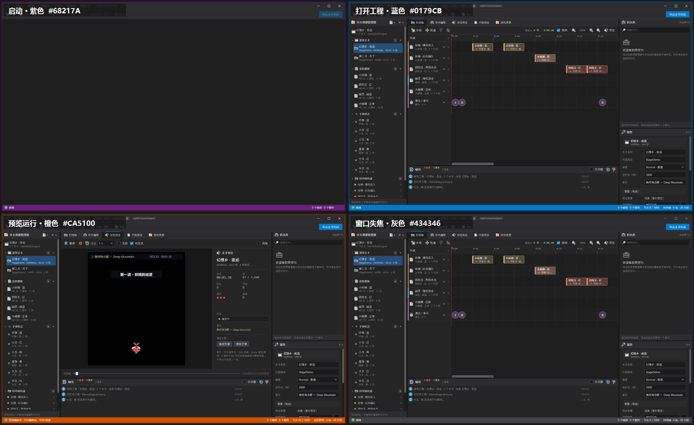

实现位于 `Controls/AccentGlowDecorator.vb`（自绘渐变光晕）与 `MainWindow.xaml.vb` 的 `ApplyAccentState`。状态切换有 240ms 的颜色过渡，窗口失焦时标题栏按钮也会同步变暗。

## 环境要求

- Windows 10 / 11
- .NET 10 SDK（已验证 `10.0.401`）
- 同级目录下存在 AgSTG 仓库：默认路径 `..\AgSTG`，即 `F:\code\AgSTG`
- 若要试玩预览与导出编译：AgSTG 的 `ResourcePack` / `ResourcePack.TH07` 可以正常构建

## 快速开始

可以在Release中寻找最新构建版本

启动后**不会自动打开任何工程**，工作区只显示 VS 深色窗口背景。使用 `文件 → 新建工程` 或 `文件 → 打开工程…` 开始编辑；`文件 → 关闭项目` 可回到空白工作区。开发/自动化场景可用 `--open <file>` 显式打开工程。

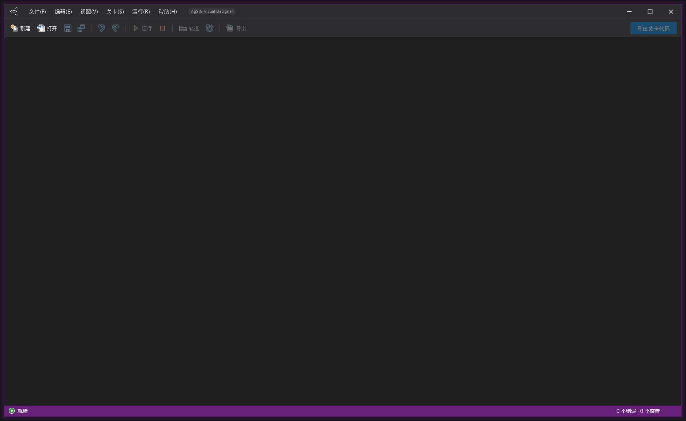

## 界面导览

- **左侧「关卡资源管理器」**：顶部「游戏关卡」列出全部关卡，单击切换；右键可重命名/复制/删除；下方显示当前关卡的敌机模板、子弹样式、轨道。
- **文件菜单**：新建/打开游戏工程、保存/另存为、导出游戏工程、关闭项目；关闭项目后回到纯背景工作区。
- **中央文档标签**：`时间轴`、`积木编程`、`背景编辑`、`试玩预览`、`代码预览`、`游戏资源` 六个视图，快捷键 `Ctrl+1~6`。
- **右侧上方「积木库」**：打开行为后显示适用于敌机或子弹的积木；支持搜索。未打开行为时显示引导。
- **右侧下方「属性」**：随选择动态显示关卡、轨道、片段、敌机模板、子弹样式或积木的属性。颜色下拉只列出该敌机/子弹类型在引擎资源中实际存在的纹理颜色变体（敌机按类型 1/2/4/8 色；子弹 11~18 为 8 色、20 为 4 色，其余 16 色）。
- **底部「输出」**：实时校验结果与操作日志；`F7` 重新验证。
- **状态栏**：关卡错误/警告数、当前 Tick、当前视图与轨道/片段统计；背景色与窗口外发光同步（紫/蓝/橙/灰）。

## 时间轴编辑

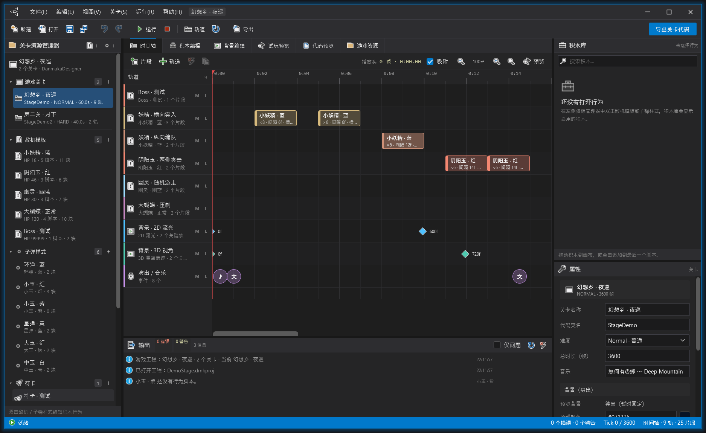

- 拖动片段：改变开始时间；拖动片段**右边缘**：调整生成数量（间隔 > 0 且数量 > 1 时可用）。背景动画使用菱形关键帧，拖动关键帧改变时间。
- 双击空白轨道：在鼠标位置生成片段/关键帧；双击敌机片段：直接编辑该敌机的积木行为；双击事件片段：聚焦属性面板；双击背景关键帧：跳到对应背景图层。
- 背景动画轨道右键选择「在此添加循环事件」：属性中设置循环起始帧、循环结束帧和循环长度；循环区间必须早于事件帧，区间内不能包含其他循环事件。时间轴上的循环片段宽度表示循环长度。
- 背景动画片段的属性顶部有「类型」：可以在「关键帧事件」和「循环事件」之间切换；切换为循环时会自动生成一段合法的默认循环区间，之后可继续调整。
- 「轨道」菜单可添加敌机、事件或**背景关键帧**轨道；背景关键帧轨道需要在「背景编辑」中先创建图层。
- 标尺拖动 / 轨道空白处点击：移动播放头并跳转预览帧。
- 顶部工具栏：添加片段、添加轨道、删除、复制、吸附、缩放、适配窗口。
- 右键片段 / 轨道 / 空白区域：属性、复制、删除、对齐播放头、切换模板等。
- 吸附：默认吸附到时间轴当前显示的小网格；`Shift` 吸附到主刻度；`Alt` 临时关闭吸附。移动、缩放、新建片段和移动播放头都会使用同一套吸附步长。
- `Ctrl + 滚轮` 缩放时间轴；`Delete` 删除片段；`Ctrl+D` 复制片段。
- 事件轨道使用圆形标记表示音乐、清弹、震动、结束关卡，悬停可看详情。
- 音乐事件的属性面板会列出「游戏资源」中导入的音频，并可单独填写显示曲名；关卡属性不再单独设置音乐。

## 积木编程


行为程序由若干**脚本**组成，每个脚本以一个事件积木开头；同一个事件下的积木按顺序执行。

积木面板会根据当前对象自动过滤：普通小怪不显示 `Boss 初始化`、`符卡开始/每帧`、`进入下一张符卡` 等 Boss 专属积木；只有 Boss 模板和符卡行为才显示这些积木。粒子行为使用独立的「粒子」积木分类。

### 事件积木（帽子）

| 积木 | 执行时机 | 适用范围 |
| --- | --- | --- |
| 当生成时 | 敌机 Tick=0；子弹从第 11 帧（可碰撞）开始 | 通用 |
| 每帧 | 每一帧 | 通用 |
| 每 N 帧 | `Ticks Mod N = 0` | 通用 |
| 当存在时间 = N | 仅一次 | 通用 |
| 当存在时间在 A ~ B | 区间内每帧 | 通用 |
| 当血量 ≤ P% | 仅一次，进入二阶段常用 | 敌机 |
| 当自机距离 < D | 条件成立时每帧 | 通用 |
| 当被击破时 | HP 归零帧一次 | 敌机 |

### 运动积木

设置/增加速度、设置/增加方向、随机方向、朝向自机、移动到坐标、移至中心（Boss/符卡）、Boss 默认移动、设置位置、停止移动。

方向约定与引擎一致：**屏幕上方为 0°，顺时针递增**。

### 攻击 / 演出积木

- 发射环形弹幕：子弹数量、子弹样式、速度、起始角、总角度。
- 发射自机狙：数量、样式、速度、扩散扇形角。
- 发射单发子弹：样式、速度、方向。
- 发射激光：颜色、方向、宽度、长度、存在帧数。
- 消除场上所有子弹、播放音效、屏幕震动。

发射积木通过「子弹样式」决定子弹类型、颜色以及**子弹自己的积木行为**。例如示例中的「环弹 · 蓝」会每 30 帧增加 8° 方向，形成旋臂；「小玉 · 红」会等待 24 帧后加速。

### 控制积木

- 等待 N 帧：暂停当前脚本后继续；**只能放在脚本顶层**（不能放进如果/重复里）。
- 重复 N 次：同一帧内立即循环；需要按帧重复请用「每 N 帧」。
- 如果 / 否则：条件对象支持存在时间、血量%、距离、自机 X/Y、自身 X/Y、变量、随机数、处于符卡阶段。
- 设置变量 / 变量增加 / 停止这个脚本。

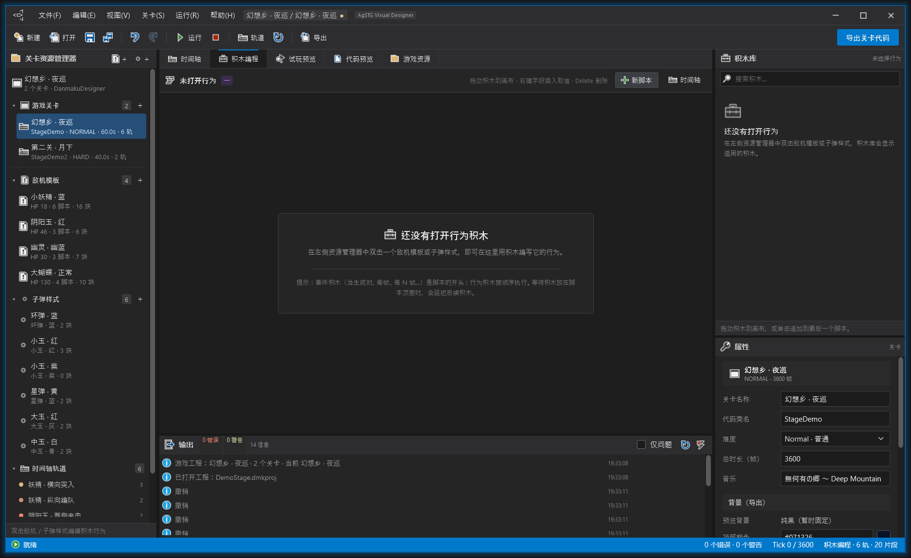

### 取值器（字段内右键）

数字字段可以右键选择「插入取值器」：

`存在时间`、`血量%`、`自机 X/Y`、`与自机距离`、`自身 X/Y`、`场上子弹数`、`场上敌机数`、`随机范围`、`变量`。

当前行为中已经用「设置变量」或「变量增加」定义的自定义变量，会直接列在右键菜单的「自定义变量」分组里；选择后即可用于子弹角度、速度、数量等数字字段。例如把变量 `ang` 用于发射方向，生成代码会读取 `V_ang`。

插入后字段会变成深色的取值器胶囊；右键胶囊可以改回数字。

### 操作

- 从右侧积木库拖入事件积木 = 新建脚本；拖入行为积木 = 追加到最后一个脚本。
- 单击积木库项也会追加（事件积木会新建脚本）。
- 在画布内拖动积木可改变顺序或放入 C 形积木的主体，会有蓝色插入线和主体高亮。
- 右键积木：删除、复制、清空「否则」分支。
- `Delete` 删除选中积木；`Ctrl+D` 复制。

## 试玩预览


- `F5` 播放/暂停，`F6` 从头播放，`Shift+F5` 停止，`Space` 播放/暂停。
- 方向键移动自机，`Shift` 低速，`R` 重新开始。
- 播放速度 0.5× / 1× / 2×；可开启「无敌」「判定点」「网格」。
- 「造成伤害」按钮对所有敌机造成 15% 最大血量伤害，用于测试血量阶段；「清除子弹」用于观察消弹演出。
- 播放头与时间轴联动；在时间轴跳转后切回预览会显示对应帧。
- 时间轴长度用完不会自动结束关卡，预览会继续运行；需要结束关卡时使用「关卡结束，进入下一关」积木。
- 预览使用编辑器内置解释器，与导出 VB 代码共享同一套积木语义；引擎模式下则直接使用 AgSTG 运行。
- 调试模式不显示残机、擦弹和单独的敌机/子弹数量；实体数直接读取 `STG.Objects.Count`，并显示 FPS 与帧耗时曲线。被弹不会因残机耗尽而结束。


### 引擎预览

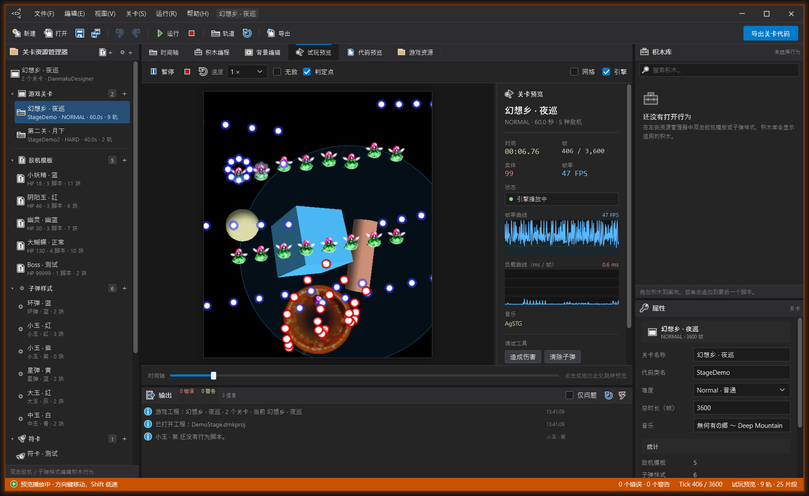

预览面板工具栏右侧的「引擎」勾选后（默认开启），编辑器不再使用独立窗口，而是把 AgSTG 的 `STG` 控件直接放进预览面板：

- 当前关卡的时间轴和积木行为会即时装入 `STG`。
- 直接使用 AgSTG 的渲染、碰撞、自机、Boss、符卡和音效逻辑。
- 不需要导出工程、启动外部进程或等待 `dotnet build`。
- 背景由背景编辑器实时绘制，叠加在 `STG` 的 `BackLayer` 上。
- 右侧实时显示 FPS 曲线和每帧负载曲线（每 20 帧采样一次）；实体数量直接读取 `STG.Objects`。
- 调试模式固定为无限残机，不显示残机和擦弹，被弹不会结束游戏。
- 取消勾选「引擎」可以切回内置解释器，方便快速拖动时间轴。

## 背景编辑与 3D 建模

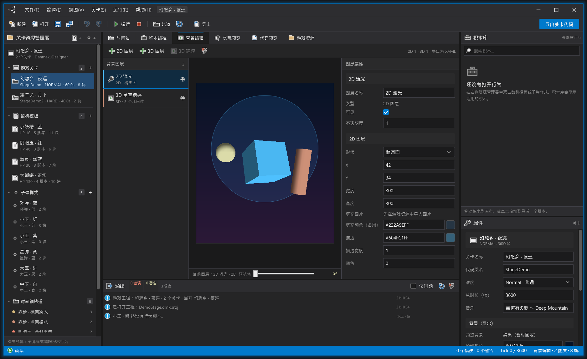

打开 `背景编辑` 标签（`Ctrl+6`）：

- 工具栏可添加 **2D 图层**、**3D 图层**，或删除当前图层。
- 预览区底部提供「预览帧」滑块，可以按时间轴帧预演背景动画。
- 2D 图层支持矩形面、椭圆面和粒子场；属性包括位置、尺寸、填充、描边、粒子数量/颜色/速度/散布。
- 粒子效果支持 2D 与 3D：点击背景编辑工具栏的「2D 粒子」直接创建 2D 粒子场（也可以把 2D 图层形状改为「粒子场」）；3D 图层在属性中选择「3D 粒子」。2D 使用引擎 `Particle`，3D 使用引擎 `Particle3D`，点击「编辑粒子积木…」编写粒子的生成/每帧行为。
- 粒子积木包括设置/增加速度、设置位置、尺寸、寿命、透明度和颜色；2D 模式忽略 Z 坐标。
- 条件事件积木：2D 粒子提供「当粒子 X/Y 大于/等于/小于数值」，3D 粒子提供 X/Y/Z 三个坐标轴；条件满足时每帧执行内部积木。
- 「粒子图片」可以选择游戏资源中的图片作为 2D / 3D 粒子填充；留空时使用粒子颜色。
- 图层的「模糊半径」大于 0 时，会对整个图层应用 `BlurEffect`；2D 形状、2D 粒子画布和 3D `Viewport3D` 都支持。
- 2D 矩形/椭圆可以从「游戏资源」中选择图片作为填充；3D 的矩形面和三角形面也可以选择图片贴图。导出资源包时会一并嵌入图片。
- 点击颜色输入框旁的颜色方块会打开调色盘，提供预设色、透明色和自定义 `#RRGGBB` / `#AARRGGBB` 输入；轨道颜色和图层颜色也使用同一个调色盘。

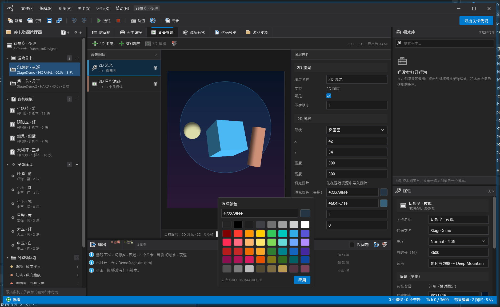
- 3D 图层包含摄像机、环境光和方向光；点击「打开 3D 建模工具…」打开独立建模窗口。
- 图层顺序就是绘制顺序：列表上方为画面前方。每行右侧的 ▲ / ▼，或属性面板的「上移一层 / 下移一层」，都可以调整顺序；导出时 2D 图层会变成 `Rectangle` / `Ellipse` / 粒子 `Canvas`，3D 图层会变成带 `Viewport3D`、`PerspectiveCamera` 和 `GeometryModel3D` 的背景 XAML。

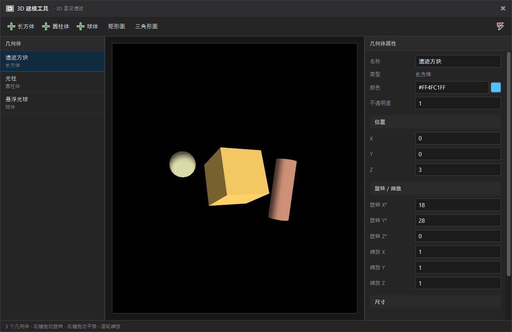

建模窗口支持：

- 长方体、圆柱体、球体、矩形面、三角形面。
- 编辑几何体的位置、旋转、缩放、尺寸/半径、分段、颜色和透明度。
- 几何体列表右键可以复制或删除几何体；复制品会插入原几何体后面，并保持完全相同的坐标和属性。
- 几何体列表上方为画面前方；每行右键的「上移一层 / 下移一层」或属性面板按钮可调整透明贴图的遮挡顺序。
- 预览视角：**左键拖动围绕中心旋转，右键拖动平移，滚轮缩放**。
- 选中的几何体在预览中高亮；修改立即写回当前 3D 图层。

背景时间轴使用**关键帧动画**：

- 每个背景轨道由若干菱形关键帧组成，帧间按绝对位置/朝向/参数线性插值。
- 3D 图层：关键帧保存摄像机位置、朝向、FOV。
- 2D 图层：关键帧保存位置、缩放、旋转、透明度。
- 粒子场：关键帧保存粒子速度和透明度。
- 3D 关键帧属性面板中的「选择视角…」会打开独立视角窗口：`WASD` 在水平面移动，`Space` 上升、`Shift` 下降，鼠标移动控制朝向；`Enter` 确认，`Esc` 取消。键盘和鼠标都按帧读取，移动更平滑。

## Boss 模板与符卡

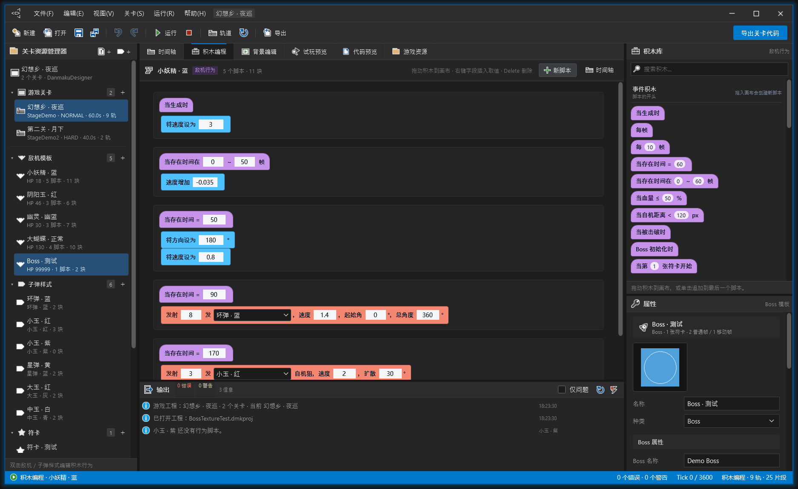

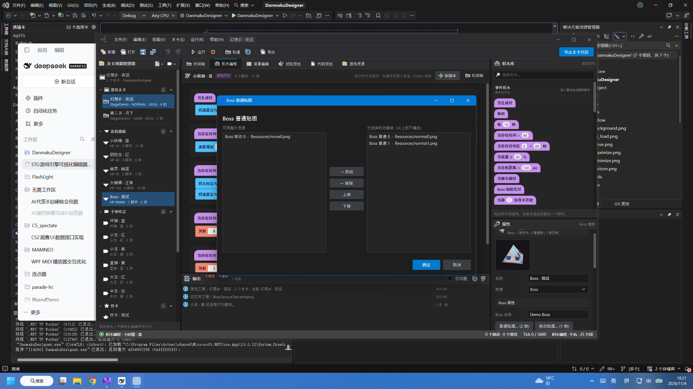

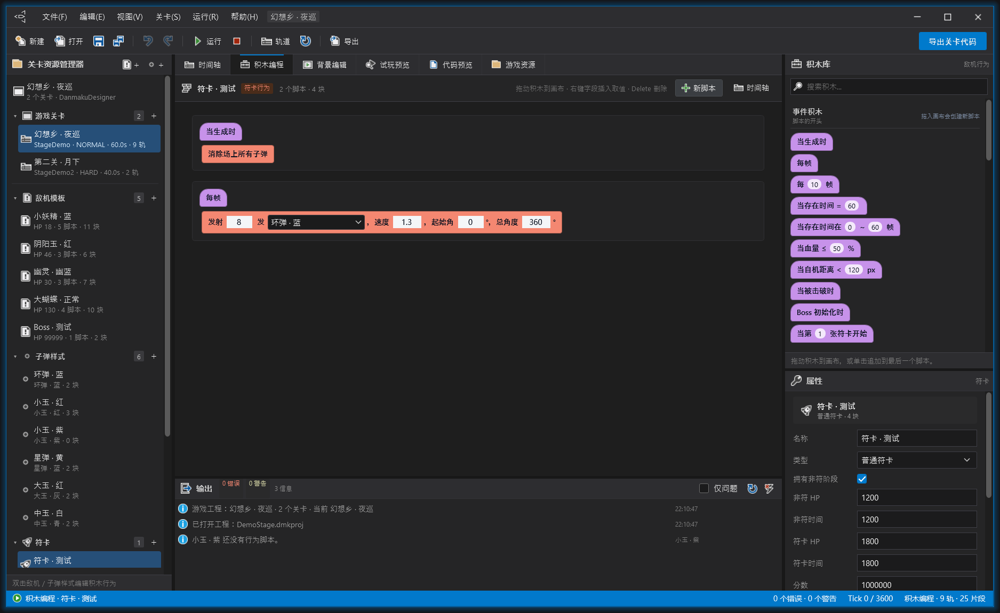

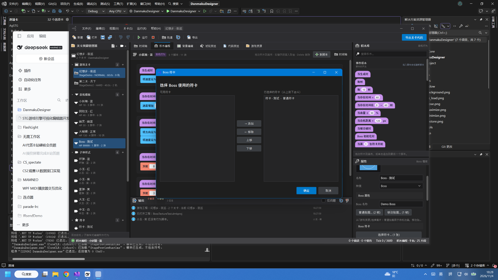

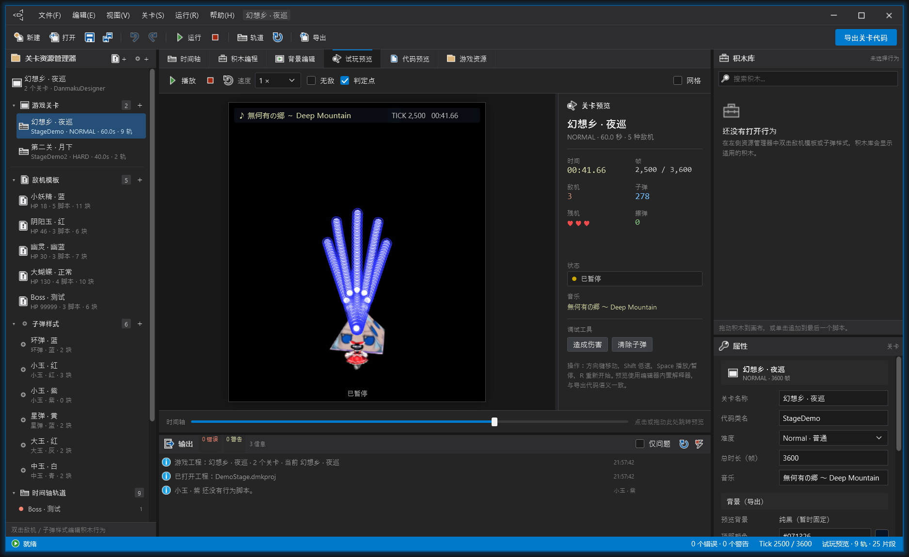

在敌机模板属性中把「种类」设为 **Boss** 后，可以设置：

- 贴图：点击「普通贴图…」或「移动贴图…」，在双列表框中选择「游戏资源」里的图片。
  - 左侧为可用图片资源，右侧为已选动画帧。
  - 添加、移除后可以用上移/下移调整播放顺序。
  - 普通贴图用于待机动画，移动贴图用于 Boss 移动动画。
  - 导出的关卡会把图片注册到 `Boss.NormalTextures` / `Boss.MoveTextures` 标准数组中。
- Boss 名称。
- 在「Boss 符卡」区域点击「选择符卡…」，左侧选择符卡加入，右侧调整 Boss 的符卡战斗顺序。

符卡统一放在左侧「关卡资源管理器 → 符卡」：

- 点击 `＋` 新建符卡，选中后右侧属性面板编辑名称、类型（仅非符 / 普通符卡 / 时符）、非符 HP/时间、符卡 HP/时间、分数、掉落物和阶段数。
- 双击符卡打开它的积木编辑器，使用「当生成时 / 每帧 / 每 N 帧 / 当存在时间 = N」等事件编写这个符卡的弹幕效果。
- Boss 属性面板只负责选择符卡以及排列它们的顺序（右侧列表顺序即战斗顺序）。

Boss 积木：

- `Boss 初始化时`：Boss 创建时执行一次，适合设置移动、清弹、初始演出。
- Boss 生成后默认处于待命状态，不会自动开始符卡；需要用「进入下一张符卡」积木或对话结束后选择「Boss 开打」来启动。
- `当第 N 张符卡开始` / `第 N 张符卡每帧`：Boss 模板行为中使用，阶段属性可选「全部阶段 / 非符阶段 / 正式符卡阶段」。
- 符卡自身行为中使用 `非符阶段开始`、`非符阶段每帧`、`正式符卡阶段开始`、`正式符卡阶段每帧` 四个独立事件积木；非符阶段和正式符卡阶段不会混在一起。
- `进入下一张符卡`：手动推进 Boss 符卡阶段。
- `关卡结束，进入下一关`：显式结束当前关卡并进入下一关；适合放在 Boss 被击破后的积木脚本里。
- `播放对话`：播放选中的对话资源；对话结束后执行对话属性中的后续动作。
- `播放音乐`：从游戏资源的音频中选择歌曲并填写显示曲名；留空曲名时使用资源名称。导出后通过 ManagedBass 播放实际音频，并同步显示曲名。

导出的关卡会生成 `Enemy.Boss` 初始化、Boss 行为类和符卡类，并按 Boss 勾选的符卡顺序接入对应行为；Boss 贴图来自本工程的游戏资源。

## 对话

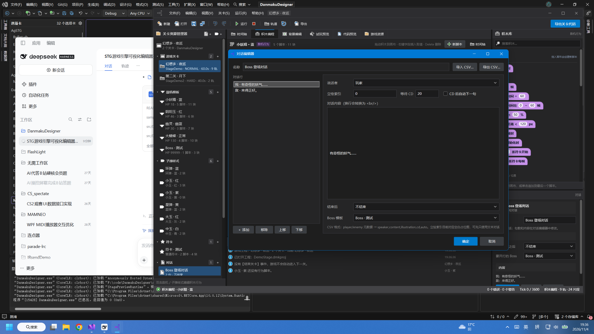

左侧「关卡资源管理器 → 对话」可以创建、重命名、复制和删除对话；双击对话或点击属性面板的「编辑对话…」打开编辑器。

编辑器支持：

- 说话者：玩家 / 敌方。
- 对话内容：换行会导出为 AgSTG 的 `<br/>`。
- 每一句都可以单独选择「本句立绘」；对话属性中还可以设置双方默认立绘。
- 等待 CD、CD 结束后自动下一句。
- 导入 / 导出 AgSTG CSV。

对话属性中的「结束后」可以选择：

- 不结束：只关闭对话。
- Boss 开打：让当前场上已经存在的待命 Boss 进入攻击状态并开始第一张符卡，不会创建新 Boss。
- 进入下一关：结束当前关卡并进入下一关。

在积木中使用「控制 → 播放对话」选择对话资源。导出的关卡代码会用内存 CSV 调用 AgSTG `DialogArea.LoadDialog`，并注册 `Changed` 事件处理后续动作。

CSV 格式与 AgSTG 一致：

```csv
player,enemy,,,
0,0,,,
speaker,content,illustration,cd,auto
0,第一句,0,15,0
1,第二句<br/>换行,0,30,1
```

前两行是元数据和立绘信息，第三行是字段标题；播放时会跳过这些行，不会把它们当作台词。每一句的 `illustration` 会按该句选择的立绘自动映射到玩家/敌方立绘数组索引。

## 游戏资源管理

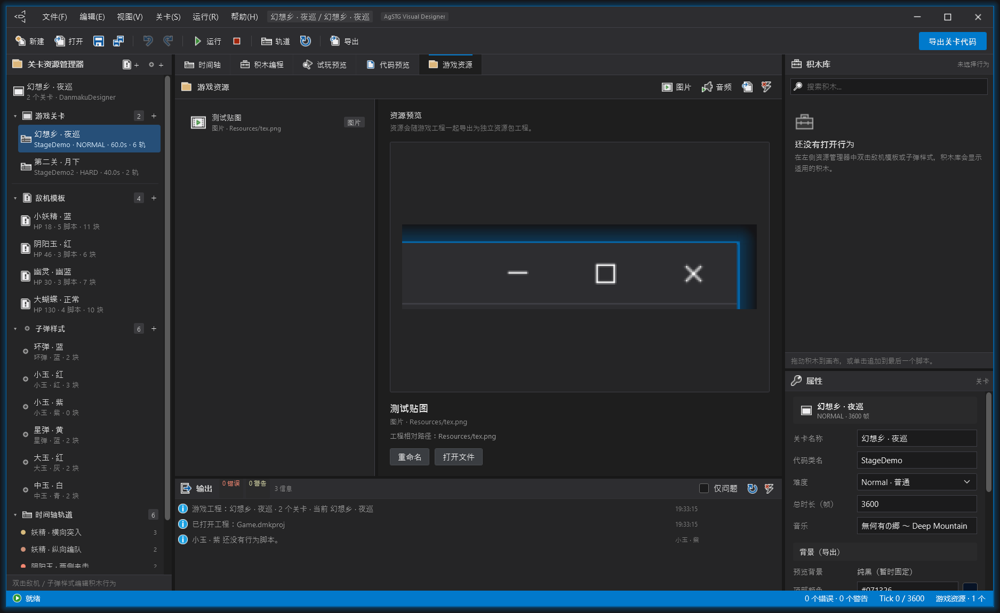

打开 `游戏资源` 标签（`Ctrl+5`）可以管理跨关卡共享资源：

- `图片` / `音频` 按钮导入外部文件，文件会复制到工程目录下的 `Resources\`。
- 资源列表显示名称、类型和相对路径；右侧可以预览图片、重命名、打开原文件。
- 移除资源只删除工程中的登记，不删除磁盘文件。
- 导出时，所有登记资源会被复制进独立的 `GameResources` 资源包工程，并生成 `GameAssetCatalog.Image(id)` 等访问器。

## 游戏属性

在左侧资源管理器选中游戏根节点，右侧属性面板可以设置：

- 启动页面背景
- 标题页面背景
- 游戏页面背景
- 标题页面 BGM

背景从「游戏资源」的图片中选择，BGM 从音频中选择；留空时使用导出模板保留的默认主题图和默认标题 BGM。

## 导出完整解决方案

`文件 → 导出解决方案…` 或 `Ctrl+E`。

导出器使用编辑器目录中的 `EngineTemplate.zip`：先解压整套 AgSTG 引擎，再替换模板中的旧关卡和 `ResourcePack.TH07`，改写 TH07 外壳，最后生成完整解决方案。

```text
GameExport\
  AgSTG\ AgSTG.Controls\ AgSTG.Core\ ResourcePack\   引擎本体，保持原样
  dll\                                                Bass 等原生依赖
  GameResources\
    GameResources.vbproj                             本游戏的图片/音频资源包
    Resources\...
  GameExport\
    GameExport.vbproj                                由 TH07 外壳改写而成的启动项目
  Stages\
    Stage1\
      Stage1.vb                                      生成的关卡
      Stage1bg.xaml
      Stage1.vbproj
    Stage2\ ...
  GameExport.slnx                                    完整解决方案
  README-解决方案说明.txt
```

导出时会：

- 保留 `AgSTG`、`AgSTG.Controls`、`AgSTG.Core`、`ResourcePack` 不变。
- 删除模板中的旧 `Stage1..Stage6`。
- 删除模板中的 `ResourcePack.TH07`。
- 用 `GameResources` 替代原来的 TH07 专属资源包。
- 将 `TH07` 项目重命名为游戏代码名，修改根命名空间、程序集名、项目引用、关卡注册和窗口标题。
- 保留原 TH07 按钮贴图和默认主题图，复制到生成的 `GameResources\UI`，外壳按钮继续使用这些贴图。
- 根据游戏属性应用启动/标题/游戏页面背景图和标题 BGM；未选择时使用保留的默认素材。
- 生成 `Stages\Stage1..StageN` 及对应项目引用。

打开导出的 `.slnx` 即可还原并生成整个解决方案，不再需要手动添加关卡工程或修改 `AgSTG.sln`。

导出完成后会询问是否立即编译：

- 有 .NET 10 SDK：执行 Release 编译，并在资源管理器中选中生成的 exe。
- 没有 .NET 10 SDK：提示安装，并打开微软官方 .NET 10 下载页面。
- 也可以稍后使用 `运行 → 编译并运行…` 编译并启动上次导出的解决方案。

> 导出会覆盖目标目录中的旧关卡、`GameResources` 和游戏外壳目录。请把手工修改留在 `.dmkproj` 源工程里，而不是生成代码中。

## 编程接口与数据

- 工程文件：UTF-8 JSON，扩展名 `.dmkproj`；根节点是 `GameProject`，包含 `stages`（多个关卡）和 `resources`（共享资源）；每个关卡还包含 `backgroundLayers`（2D/3D 背景图层）和背景动画轨道。旧的单关卡文件会自动包装成一个关卡。模型定义在 `src/DanmakuDesigner.Core/Model.vb`。
- 背景几何：`BackgroundGeometry.vb` 展开长方体/圆柱/球体/矩形面/三角形面；`BackgroundCodeGen.vb` 生成背景 XAML 与动画代码。
- 积木定义：`src/DanmakuDesigner.Core/Blocks.vb`，新增积木时只需要定义字段、部件、作用域和帽子类型，解释器与代码生成器会共享同一份定义。
- 解释器：`Interpreter.vb`；生成器：`CodeGen.vb`；校验器：`Validator.vb`。
- 编辑器 UI：`src/DanmakuDesigner/Views`；主题：`Themes/DarkTheme.xaml`；VS 图标：`Assets/Icons`。

### 目录

```text
DanmakuDesigner.slnx
src/
  DanmakuDesigner.Core/     模型、积木定义、解释器、代码生成、校验、JSON
  DanmakuDesigner/          WPF 编辑器
    Views/                  时间轴、积木、背景编辑/3D 建模、资源管理、属性、输出、预览、代码
    Controls/               自绘弹幕预览渲染器、窗口外发光装饰器
    Dialogs/                输入、导出对话框
    Themes/                 VS Dark 主题
    Assets/Icons/           VS2017 图标（16px）
    Assets/Window/          标题栏位图按钮（最小化/最大化/还原/关闭）
tests/
  DanmakuDesigner.Smoke/    Core 冒烟测试（含导出样例与编译前检查）
samples/
  DemoStage.dmkproj         示例游戏（两个关卡、背景图层、共享资源列表）
docs/screenshots/           界面截图
```

## 开发与测试

```powershell
# 全量构建
dotnet build DanmakuDesigner.slnx

# Core 冒烟测试：JSON 往返、预览运行时、校验、代码生成、样例导出
dotnet run --project tests\DanmakuDesigner.Smoke\DanmakuDesigner.Smoke.vbproj

# 编辑器 UI 自检（会临时改动内存中的示例工程并验证撤销/重做/放置）
DanmakuDesigner.exe --uitest

# 无界面导出，用于 CI 或脚本
DanmakuDesigner.exe --export D:\Temp\GameExport
```

编辑器支持以下开发/自动化参数：

| 参数 | 说明 |
| --- | --- |
| `--open <file>` | 启动时打开工程 |
| `--tab timeline\|blocks\|background\|preview\|code\|resources` | 启动后切换视图 |
| `--template <id>` / `--pattern <id>` | 打开指定模板/样式的积木行为 |
| `--preview-tick <n>` | 预览跳转到指定帧 |
| `--play` | 启动后自动播放预览 |
| `--capture <png>` + `--delay <ms>` | 渲染窗口截图后退出 |
| `--uitest` | 运行 UI 自检 |
| `--export <dir>` | 无界面导出后退出 |

## 已知限制 / 路线图

- 暂不支持音频试听；音乐事件或「播放音乐」积木选择音频资源后，导出时会用 ManagedBass 播放实际音频，并显示曲名。
- 一个工程对应一个关卡；多关卡工程、复制/粘贴跨行为脚本尚未实现。
- 变量只支持数值；没有列表/字符串变量。
- 引擎预览使用 AgSTG 完整逻辑；内置解释器只用于快速调试，不模拟自机射击、擦弹得分、掉落物等完整游戏逻辑。

## 素材与致谢

- 引擎：[AgSTG](https://github.com/MC-AGANG/AgSTG)，本项目为这个引擎的配套项目。
- UI 图标：Microsoft **Visual Studio 2017 Image Library**（`VS2017`），仅用于界面展示。
- 弹幕/敌机贴图：版权归上海爱丽丝幻乐团所有，仅用于功能展示。
- 示例游戏中的音乐名与东方 Project 相关名称仅用于同人示例。

本工具仅生成引用引擎的代码，不修改 AgSTG 引擎本体。请遵守 AgSTG 与相关素材的授权约定。
